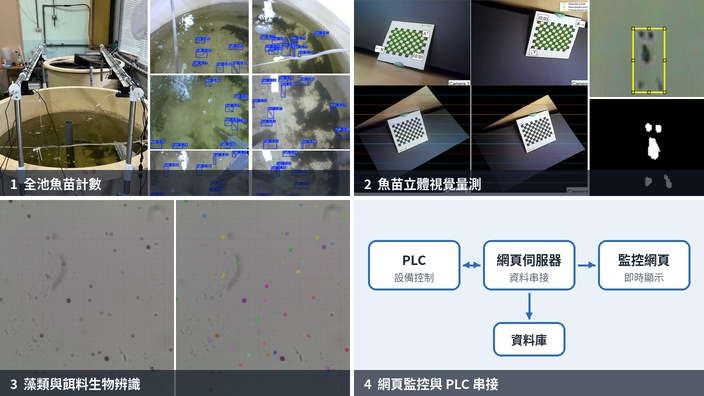
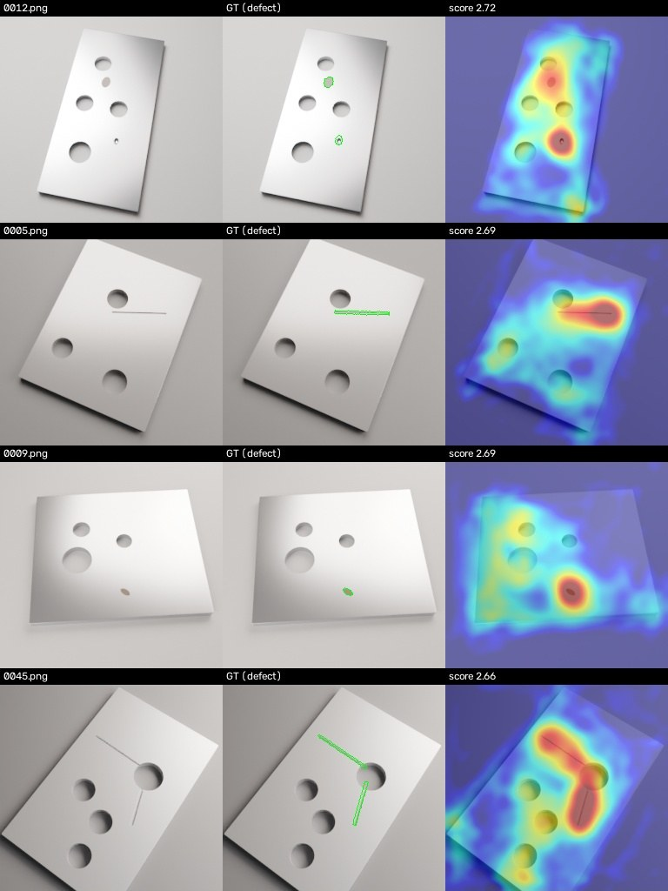

# Hi, I'm Rung-Chi Lin

**Computer vision · Optical metrology · 3D reconstruction**

I'm a Ph.D. student. I build research systems that connect vision algorithms, imaging hardware and experimental validation.

## Research & development

Since 2018 I have built camera-based measurement systems end to end, from imaging hardware to validated results:

  

- **Multi-view and stereo vision:** an 8-camera full-tank fry counting system with LoFTR + homography mosaicking and cross-view de-duplication (ICASI 2025); a validated stereo system for non-contact fry monitoring (*Aquacultural Engineering*, 2026).
- **Structured light and calibration:** a Blender-based virtual structured-light system with ray-traced ground truth, and a "3D precision volume" that maps where a calibration can be trusted (ICASI 2026); a C++ projector–camera system for robotic-arm object segmentation (M.S. thesis).
- **Neural 3D reconstruction:** COLMAP, instant-ngp and Nerfstudio pipelines for NeRF / 3D Gaussian Splatting in industry projects, extended to robotic grasping and image inspection.

Lab and industry code is proprietary; the open-source repositories below are re-implementations and tooling on public or synthetic data. Project write-ups will be published on my personal site.

## Open source

🔧 **[synthetic-defect-detection](https://github.com/LinRungChi/synthetic-defect-detection)** — train a surface-defect detector without a single real defect image: a procedural Blender part with rendered defect masks, a compact PatchCore, a supervised baseline, a domain-shift study and a FastAPI service.

  

🧩 **[multiview-stitching](https://github.com/LinRungChi/multiview-stitching)** — feature-based multi-view registration, chained homography mosaicking and cross-view detection de-duplication, with a synthetic scene generator and tests.

  

🎥 **[colmap-video-toolkit](https://github.com/LinRungChi/colmap-video-toolkit)** — hand-held video to a clean COLMAP dataset for NeRF / 3D Gaussian Splatting: sharpness-filtered frame extraction, two-pass reconstruction, view selection along the camera path and match-quality diagnostics.

🗂️ **[vision-data-tools](https://github.com/LinRungChi/vision-data-tools)** — small tools for building vision datasets: Basler / OpenCV capture, threshold-based auto-labelling, mask-to-YOLO-polygon conversion, dataset split and particle counting for microscopy video.

## Tools & methods

Python · MATLAB · C/C++ · PyTorch · OpenCV · COLMAP · instant-ngp · Nerfstudio

Multi-view geometry · Camera calibration · Stereo vision · Image registration and stitching · Structured light · Detection and tracking · Semantic segmentation · NeRF / 3DGS · Measurement error analysis

## Selected publications

- Kuo, C.-Y., **Lin, R.-C.**, Chen, T.-Y., & Chiang, P.-J. *Non-contact monitoring of grouper fry weaning in recirculating aquaculture systems: Efficacy of an automated stereo vision system.* Aquacultural Engineering, 116, 102814, 2027 (online 2026). [DOI](https://doi.org/10.1016/j.aquaeng.2026.102814)
- **Lin, R.-C.**, & Chiang, P.-J. *Optimization of Structured Light System Calibration and Optimal Working Volume Estimation Based on Virtual Simulation Analysis.* Presented at ICASI 2026; proceedings forthcoming.
- **Lin, R.-C.**, & Chiang, P.-J. *A Low-Cost Multi-Camera System for Full-Tank Fish Fry Counting in Aquaculture.* ICASI 2025, pp. 332–337. [DOI](https://doi.org/10.1049/icp.2025.2563)

## 關於我

目前為博士生，研究方向涵蓋電腦視覺、光學量測與三維重建。具備從系統設計、演算法實作、軟硬體整合到實驗驗證的經驗。

我希望持續把研究方法轉化為能處理實際場域問題的視覺系統。

